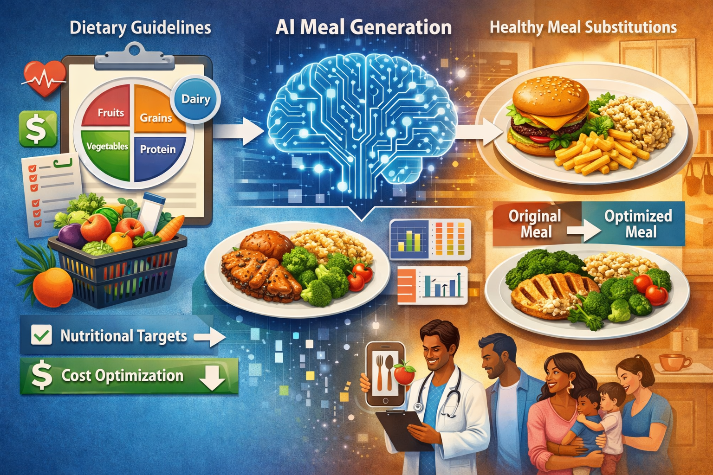

# Diet Recommendation System

Companion code for **Translating Dietary Standards into Healthy Meals with Few-Ingredient Substitutions** (*PLOS Digital Health* 5(5): e0001367, 2026; [DOI 10.1371/journal.pdig.0001367](https://doi.org/10.1371/journal.pdig.0001367); [article](https://journals.plos.org/digitalhealth/article?id=10.1371/journal.pdig.0001367)).

## Overview

Personalized nutrition tools rarely close the loop from **dietary standards** to **concrete meals** users can adopt with **minimal changes**. The paper presents an end-to-end framework that starts from USDA-linked intake data (**What We Eat in America, WWEIA** / NHANES), discovers **34 interpretable meal archetypes** (time-of-day clusters mixing nutrients and food-group composition), and trains a **conditional variational autoencoder (CVAE)**, with **FiLM conditioning** on meal type and archetype, to propose realistic food combinations. A downstream **RDI-aware portioning** step adjusts grams toward USDA targets. The pipeline then evaluates **few-hop substitutions** matched to similar real meals, improving nutrition and modeled meal cost under a transparent multi-objective policy.

The findings below are from the article (see it for definitions, statistics and figures); this repository contains the code that produces those analyses.

### Headline findings (from the paper)

- **Scale of intake data**: NHANES/WWEIA intake data for **135,491 eating-occasion meals** from the 2013–2020 survey waves; a training set of **65,202** meals and **2,018** foods (**1,475** unique), each with a **20-nutrient** panel.
- **Archetypes**: **34** interpretable clusters that pass FDR-controlled distinctiveness tests (e.g., cereal bowls, sandwiches, pizza meals), used to condition generation and for like-for-like evaluation.
- **RDI alignment of generated meals**: compared with real meals of the same archetype, generated meals **better follow daily intake (RDI) targets**: the median absolute per-meal deviation from USDA targets falls **47.0% overall** (**43.2%** breakfast, **52.1%** lunch, **46.0%** dinner), while staying compositionally close to real meals.
- **Broader diet-quality metrics**: higher **Mean Adequacy Ratio (MAR)** and better **AMDR** (Acceptable Macronutrient Distribution Range) balance, with shifts in energy density and selected micronutrients (Figure 3 and the supplement).
- **Few-ingredient substitutions**: allowing **one to three** food substitutions yields meals that are on average about **10% more nutritious** while **reducing estimated meal cost by 19–32%** under the portion-based restaurant pricing model.
- **Substitution patterns**: cost–benefit sweeps over the trade-off parameter **θ**, with category heatmaps and scatters, show interpretable shifts at the selected operating points (e.g., more vegetables and grains added, fewer removals from high-cost, low-value categories; Figure 4).

### What this repository reproduces

- **Preprocessing and clustering**: meals from the NHANES dietary recalls, food-code standardisation, prototype mapping, outlier removal (LOF) and bootstrap food filtering; hybrid nutrient and food-group features and **HDBSCAN** clustering per meal type; the 34 archetypes and Figure 2 ([`make preprocess`](Makefile), [`make clustering`](Makefile)).
- **Generative model**: the multi-meal, presence-only **CVAE** with 5-fold cross-validation (S1 Table 7) ([`make cvae_train`](Makefile)).
- **RDI evaluation**: one generated meal per real meal of each archetype, RDI-per-kcal portioning, nutrient metrics and bootstrap statistics, Figure 3 ([`make eval`](Makefile)).
- **Substitutions and θ sweeps**: one- to three-food substitutions between generated and real meals, the cost–benefit sweep over θ with knee points, and Figure 4 ([`make substitutions`](Makefile), [`make theta_sweep`](Makefile), [`make figure4a`](Makefile)).
- **Supplementary analyses**: cluster stability, sensitivity, cost-model and ablation analyses behind S1 Tables 11–19 ([`make supplementary`](Makefile); see [analyses/README.md](analyses/README.md)).
- **Manuscript export**: the Figure 2–4 panels and a log of the headline numbers with their source files ([`make manuscript-figures`](Makefile), [`make manuscript-numbers`](Makefile)).

All results are regenerated from the raw survey files; no outputs are stored in the repository. With the pinned environment, every stage is deterministic. The GPT-4o comparison in the article needs API access and cached model responses and is not part of this repository.

Full mapping of the paper's figures, tables and numbers to commands and output files: [docs/PAPER_MAPPING.md](docs/PAPER_MAPPING.md).

## Usage

### Setup

1. **Clone** this repository and work from the repository root:

   ```bash
   git clone https://github.com/AI-Institute-Food-Systems/Diet_Recommendation_System.git
   cd Diet_Recommendation_System
   ```

2. **Python**: use **3.11** (tested on Linux). All package versions are pinned in `requirements.txt`; see [docs/INSTALLATION.md](docs/INSTALLATION.md). No GPU is needed.
3. **Dependencies**: install into a virtual environment:

   ```bash
   make setup          # creates .venv and installs requirements.txt
   source .venv/bin/activate
   make verify-env     # compares installed versions with requirements.txt
   ```

   Or manually: `python3.11 -m venv .venv && source .venv/bin/activate && pip install -r requirements.txt`.

4. **Data**: the inputs are included under `data/` (NHANES dietary recall files, FNDDS food and nutrient tables, food prices); see [data/README.md](data/README.md). Nothing needs to be downloaded. Everything the pipeline writes goes to `outputs/`, `data/processed/` and `logs/`, which are git-ignored.

### Running the pipeline

Targets are defined in the **`Makefile`** (recommended entry point; `make help` lists them):

| Goal | Command | Time* |
|------|---------|-------|
| Full pipeline: raw data to manuscript figures and the numbers log | `make reproduce` | 3 h |
| Supplementary analyses (S1 Tables 11–19), after `make reproduce` | `make supplementary` | 1.75 h |
| Condition ablation (retrains two models) | `make condition-ablation` | 3 min |
| Quick check of training, evaluation and substitutions (after clustering) | `make smoke` | 35 min |
| Preprocess only | `make preprocess` | 10 min |
| Cluster only (also draws Figure 2) | `make clustering` | 25 min |
| Train CVAE only | `make cvae_train` | 30 min |
| Evaluate: generate meals, Figure 3, tables | `make eval` | 20 min |
| Substitution analysis at one θ | `make substitutions` | 15 min |
| θ sweep, knee points, Figure 4B–D | `make theta_sweep` | 1.5 h |
| Figure 4A worked example | `make figure4a` | < 1 min |
| Headline numbers log (`outputs/final_results_log.txt`) | `make manuscript-numbers` | < 1 min |
| Export manuscript Figure 2–4 panels | `make manuscript-figures` | < 1 min |

\* On a 16-core (32-thread) CPU.

Stages of a full run: `preprocess` → `clustering` → `cvae_train` → `eval` → `substitutions` → `theta_sweep` → `figure4a` → `manuscript-figures` → `manuscript-numbers`. The defaults (`SEED=42`, `RUN_NAME=eval_run`, and the other Makefile variables) are the settings used for the paper; override them on the command line, e.g. `make eval RUN_NAME=test`. `make status` prints the configured paths.

Inspect local progress:

```bash
make pipeline-status
```

Configuration files and defaults: [config/README.md](config/README.md). Output layout (including `presence_only_model/` vs `model/`) and troubleshooting: [docs/STRUCTURE.md](docs/STRUCTURE.md).

### GitHub Actions

Continuous integration runs on pushes and pull requests ([`.github/workflows/ci.yml`](.github/workflows/ci.yml)): it installs the pinned requirements and runs `make ci`, which checks the environment, the configuration files and that every entry point imports and parses its arguments. These checks need no pipeline outputs.

### Data versioning

This repository uses **Git** for code, configuration and the input data. Generated outputs (models, generated meals, figures, tables) are **not** committed; they are written to git-ignored folders and can be regenerated with `make reproduce`. The repository does not use DVC.

### Logging

Each stage writes its progress to a log under `logs/<stage>/` (`preprocessing`, `clustering`, `cvae_train`, `evaluate`, `substitutions`; `make condition-ablation` writes a timestamped log to `logs/condition_ablation/`) and prints little to the console; follow a running stage with, for example, `tail -f logs/cvae_train/cvae_train.log`. The substitution runs print one line each, and their log is appended to rather than overwritten. The preprocessing log records the meal and food counts after each step.

### Project structure

| Path | Purpose |
|------|---------|
| [`cli/`](cli/) | Pipeline entry points (`run_clustering`, `run_multi_meal_cvae`, `evaluate`) |
| [`src/`](src/) | Library code: preprocessing, clustering, CVAE models, meal generator and portioning, evaluation metrics and plots |
| [`experiments/`](experiments/) | Substitution analysis and Figure 4 |
| [`analyses/`](analyses/) | Supplementary analyses (S1 Tables 11–19) |
| [`config/`](config/) | JSON configs (`cvae_multi_meal.json`, the 34 archetypes, cluster names, manuscript figure map) |
| [`scripts/`](scripts/) | Headline numbers log, figure export, environment and status checks |
| [`data/`](data/) | Input data (see [data/README.md](data/README.md)) |
| [`tests/`](tests/) | Checks run by `make ci` |
| [`docs/`](docs/) | STRUCTURE, PAPER_MAPPING, INSTALLATION, CITATION ([`docs/README.md`](docs/README.md)) |
| [`outputs/`](docs/STRUCTURE.md) | **Generated** tree: `runs/<RUN_NAME>/`, `clustering/`, `manuscript/` |

Full layout: [docs/STRUCTURE.md](docs/STRUCTURE.md). Paper ↔ commands: [docs/PAPER_MAPPING.md](docs/PAPER_MAPPING.md).

## Documentation quick links

| Resource | Link |
|----------|------|
| **GitHub (source)** | [AI-Institute-Food-Systems / Diet_Recommendation_System](https://github.com/AI-Institute-Food-Systems/Diet_Recommendation_System) |
| **Article** | [*PLOS Digital Health*: DOI 10.1371/journal.pdig.0001367](https://doi.org/10.1371/journal.pdig.0001367) |
| Repository layout & troubleshooting | [docs/STRUCTURE.md](docs/STRUCTURE.md) |
| Paper ↔ outputs | [docs/PAPER_MAPPING.md](docs/PAPER_MAPPING.md) |
| Installation | [docs/INSTALLATION.md](docs/INSTALLATION.md) |
| Config & defaults | [config/README.md](config/README.md) |
| Input data | [data/README.md](data/README.md) |
| Supplementary analyses | [analyses/README.md](analyses/README.md) |
| Citation | [docs/CITATION.md](docs/CITATION.md) |
| Contributing, CI & releases | [CONTRIBUTING.md](CONTRIBUTING.md) |
| Changelog | [CHANGELOG.md](CHANGELOG.md) |

## Validation / CI

```bash
make ci                    # environment check + unit tests (what GitHub Actions runs)
make smoke                 # quick training/evaluation/substitution run on a separate RUN_NAME (needs clustering outputs)
make pipeline-status       # which stage outputs exist for RUN_NAME
```

`make clean-scratch` removes logs, caches and the smoke run; `make clean-generated` removes everything under `outputs/`. Details: [CONTRIBUTING.md](CONTRIBUTING.md).

## Contributing

1. Fork the repository and create a branch (e.g. `feature/your-feature`).
2. Make changes and run the checks: `make ci`, and rerun the affected pipeline stages if results could change.
3. Open a pull request against the default branch.

Expectations and review flow: [CONTRIBUTING.md](CONTRIBUTING.md).

## Authors

**Trevor Chan** and **Ilias Tagkopoulos**, Department of Computer Science, Genome Center, and USDA/NSF AI Institute for Next Generation Food Systems (AIFS), University of California, Davis.

## Contact

**Corresponding author:** Ilias Tagkopoulos, [itagkopoulos@ucdavis.edu](mailto:itagkopoulos@ucdavis.edu). For issues with the code, please use **GitHub Issues** on this repository.

## Citation

Cite the **journal article**:

> Chan T, Tagkopoulos I (2026) Translating dietary standards into healthy meals with few-ingredient substitutions. *PLOS Digital Health* 5(5): e0001367. https://doi.org/10.1371/journal.pdig.0001367

BibTeX and software citation: [docs/CITATION.md](docs/CITATION.md) and [`CITATION.cff`](CITATION.cff).

## License

Released under the [MIT License](LICENSE). The NHANES survey data under `data/raw/` are public-domain data from the U.S. Centers for Disease Control and Prevention; the FNDDS tables are from USDA Agricultural Research Service.

## Acknowledgements

We thank the members of the Tagkopoulos Lab for helpful discussions and comments.

## Funding

This work was supported by the **USDA-NIFA AI Institute for Next Generation Food Systems (AIFS)**, award number **2020-67021-32855**, and by the **NSF HDR: TRIPODS** program, grant **CCF-1934568**.

## Troubleshooting

**`CUDA_ERROR_NO_DEVICE` / "no CUDA-capable device is detected"**: TensorFlow probes for a GPU at startup. On CPU-only hosts this is harmless; work continues on CPU. Evaluation hides GPUs explicitly in `cli/evaluate.py`.

**A stage fails**: read its log under `logs/<stage>/`, fix the cause and rerun only that stage and the ones after it (e.g. `make eval substitutions theta_sweep`). Stages read their inputs from earlier stages' outputs, so there is no need to start over.

**Different numbers on another machine**: check `make verify-env`. Other package versions or CPUs can change floating-point results, and with them the trained model and everything downstream of it. More in [docs/STRUCTURE.md](docs/STRUCTURE.md#troubleshooting).
